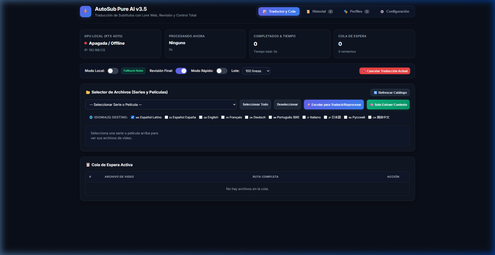
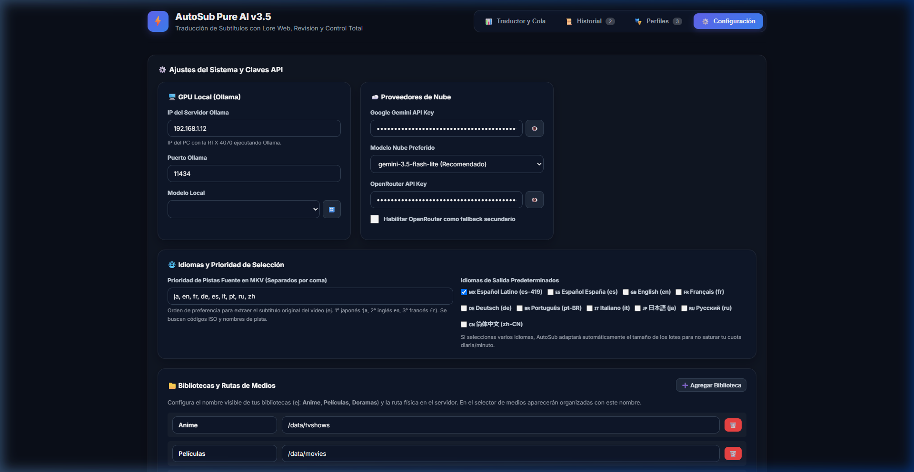

# AutoSub PureAI 🎬✨
> **Traductor Inteligente de Subtítulos con Contexto Narrativo y Panel de Control Web v3.5**  
> *Diseñado para servidores multimedia modernos (Plex, Jellyfin, Emby).*



---

## 🌟 ¿Qué es AutoSub PureAI?

A diferencia de los traductores automáticos convencionales que traducen líneas aisladas palabra por palabra (perdiendo el género de los personajes, el tono y los modismos), **AutoSub PureAI** opera bajo un enfoque **100% cognitivo**:

1. **🧠 Memoria y Perfiles de Serie (.profiles/)**: Extrae y mantiene un archivo JSON con los personajes principales, su rol exacto, pronombres y un glosario unificado para garantizar consistencia entre episodios y temporadas.
2. **📖 Análisis Contextual Previo**: Lee el episodio completo para entender el clímax, giros argumentales y relaciones entre personajes antes de traducir.
3. **✨ Revisión y Pulido (Proofreading)**: Ejecuta una segunda pasada de IA al terminar cada lote para verificar fluidez, naturalidad y eliminar cualquier inconsistencia gramatical.

---

## 🚀 Características Principales

* **🌐 Soporte para 10 Idiomas de Destino**:
  - 🇲🇽 **es-419**: Español Latinoamericano neutro (`.es-419.ass` / `.es-419.srt`)
  - 🇪🇸 **es**: Español de España / Castellano (`.es.ass` / `.es.srt`)
  - 🇬🇧 **en**: English (`.en.ass` / `.en.srt`)
  - 🇫🇷 **fr**: Français (`.fr.ass` / `.fr.srt`)
  - 🇩🇪 **de**: Deutsch (`.de.ass` / `.de.srt`)
  - 🇧🇷 **pt-BR**: Português do Brasil (`.pt-br.ass` / `.pt-br.srt`)
  - 🇮🇹 **it**: Italiano (`.it.ass` / `.it.srt`)
  - 🇯🇵 **ja**: 日本語 (`.ja.ass` / `.ja.srt`)
  - 🇷🇺 **ru**: Русский (`.ru.ass` / `.ru.srt`)
  - 🇨🇳 **zh-CN**: 简体中文 (`.zh.ass` / `.zh.srt`)

* **🎯 Selección Prioritaria de Pistas Fuente (MKV)**:
  - Extrae automáticamente la pista de mejor calidad según tu orden de preferencia configurable (ej: 1° Japonés `ja`, 2° Inglés `en`, 3° Francés `fr`...).

* **🛡️ Protección Adaptativa de Cuota (Adaptive Batching)**:
  - Si encolas múltiples idiomas simultáneamente, el sistema reduce dinámicamente el tamaño de los lotes y añade pausas de espaciado para proteger los límites de peticiones por minuto (RPM/TPM) de tu clave de API.

* **📁 Bibliotecas con Nombres Personalizados**:
  - Organiza tus rutas fácilmente desde la interfaz web (ej: Anime, Películas, Doramas) para clasificar tu catálogo en un solo clic.

* **⚡ Arquitectura Multinivel de Modelos de IA**:
  - **Primario**: `gemini-3.5-flash-lite` (Google AI Studio, ultra veloz ~2.6s por lote).
  - **Secundario**: `gemini-3.1-flash-lite` y `gemma-4-31b-it` (14,400 peticiones diarias).
  - **Local Offline**: GPU local mediante Ollama (`qwen3.5:9b`, `qwen3:14b`, etc. con detección automática de estado).
  - **Opcional**: Fallback a OpenRouter.

* **🖥️ Panel de Control Web Completo (Puerto 5055)**:
  - Monitoreo en vivo de lotes, progreso en tiempo real y tiempos de respuesta.
  - Encolado por lotes con un solo clic.
  - Modo *"Solo Extraer Contexto"* (ideal para series que ya tienen subtítulos pero quieres indexar su perfil narrativo).
  - Editor interactivo de personajes y glosario.

---

## 🛠️ Requisitos del Sistema

- **Python 3.10+** (utiliza principalmente la librería estándar).
- **MKVToolNix** (`mkvmerge` y `mkvextract` instalados en el sistema).
  - En Debian/Ubuntu: `sudo apt install mkvtoolnix`
  - En Windows: Añadir la carpeta de MKVToolNix al PATH.
- (Opcional) Clave de API de Google Gemini (nivel gratuito o de pago) y/o Ollama local.

---

## 📦 Instalación Rápida

1. **Clonar el repositorio**:
   ```bash
   git clone https://github.com/devil1210/AutoSub-PureAI.git
   cd AutoSub-PureAI
   ```

2. **Configurar variables de entorno**:
   ```bash
   cp .env.example .env
   # Edita .env con tus claves o configúralas directamente desde la interfaz web
   ```

3. **Iniciar el servidor**:
   ```bash
   python autosub.py
   ```

4. **Acceder a la Web**:
   Abre tu navegador en: [http://localhost:5055/](http://localhost:5055/)

---

## ⚙️ Ajustes del Sistema



Desde la pestaña **Configuración** podrás gestionar:
- Claves de API (Google Gemini / OpenRouter).
- Conexión y detección de modelos de tu GPU local con Ollama.
- Idiomas de salida predeterminados y orden de prioridad de subtítulos en MKV.
- Lista interactiva de bibliotecas de medios monitoreadas.

---

## 📄 Licencia

Distribuido bajo la Licencia MIT. Consulta el archivo [LICENSE](LICENSE) para más detalles.
