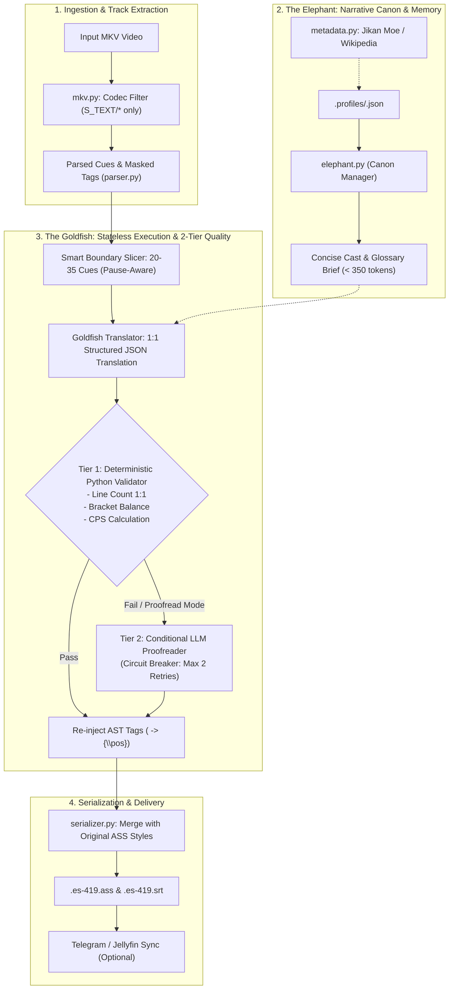

# AutoSub PureAI v4.0: Modular Architecture & Elephant-Goldfish Subtitle Engine

*   **Author:** devil1210
*   **Status:** Approved
*   **Date:** 2026-11-13 (Updated with EGM Goldfish Consensus)

--------------------------------------------------------------------------------

## Overview

AutoSub PureAI is an intelligent subtitle translation and media server synchronization daemon designed for automated home-server pipelines (Plex, Jellyfin, Emby). It extracts subtitles from Matroska (MKV) containers, enriches series and episode narrative context using AI models (Google Gemini, local GPU instances via Ollama, or OpenRouter fallback), translates dialogue into up to 10 target languages with format preservation (.ass / .srt), and presents an interactive web dashboard for monitoring and queue management.

This specification establishes the v4.0 architectural modernization of AutoSub PureAI:
1. Decomposing the legacy 3,827-line monolithic script (`autosub.py`) into cleanly separated packages (`autosub/core`, `autosub/subtitles`, `autosub/providers`, `autosub/engine`, `autosub/web`).
2. Decoupling the embedded web presentation layer (HTML/CSS/JS strings) into standalone static assets and templates served via standard HTTP caching.
3. Implementing the **Elephant-Goldfish Model (EGM)** inside the translation engine to eliminate context pollution, line hallucination, and model fatigue while guaranteeing series-level narrative consistency.

### Domain Glossary & Acronyms
*   **MKV (Matroska Video)**: Open-standard video container holding multiple audio, video, and subtitle streams.
*   **Demuxing**: Splitting an MKV container into its elementary audio, video, and subtitle streams via MKVToolNix CLI tools (`mkvmerge`, `mkvextract`).
*   **ASS (Advanced SubStation Alpha)**: Feature-rich subtitle format supporting styling sections (`[Script Info]`, `[V4+ Styles]`, `[Events]`) and inline override tags (`{\pos(x,y)}`, `{\fad(200,200)}`, `\N`).
*   **SRT (SubRip Subtitle)**: Lightweight, plaintext subtitle format consisting of sequential numeric counters, start/end timestamps, and lines of dialogue.
*   **CPS (Characters Per Second)**: Standard subtitle reading speed metric calculated as $\text{characters} / \text{duration in seconds}$. Standard ceiling is $\le 20$ CPS for comfortable viewer reading.
*   **RPM (Requests Per Minute)**: Provider API rate limit constraint (e.g., Google Gemini Free Tier 10 RPM).
*   **es-419**: BCP 47 and UN M.49 language tag representing neutral Latin American Spanish.

--------------------------------------------------------------------------------

## The Problem

The implementation in `autosub.py` (180 KB, ~3,827 lines) has reached architectural saturation:
*   **Monolithic entanglement**: Subtitle extraction, LLM provider clients, rate-limiting locks, background worker threads, file-system watchers, and the HTTP server share global mutable state (`QUEUE`, `CONFIG`, `CURRENT_TASK`, `SERIES_PROFILES`).
*   **Embedded presentation layer**: Over 1,600 lines of CSS, JavaScript, and HTML are hardcoded as raw Python string literals within the request handler, preventing frontend linting, syntax highlighting, and asset caching.
*   **Context degradation in translation**: Monolithic translation prompts face *context pollution* (hallucination, line skipping, or model fatigue when prompts exceed optimal attention spans) or *context starvation* (isolated line-by-line batches losing character gender, relationships, and established terminology).
*   **Absence of automated testing**: Subprocess execution, web handling, and AI orchestration are coupled in one file, requiring manual test runs with live video files and paid API credits to verify changes.

--------------------------------------------------------------------------------

## Goals

*   **Goal 1: Modular Decoupling**: Decompose `autosub.py` into distinct packages (`autosub/core`, `autosub/providers`, `autosub/subtitles`, `autosub/engine`, `autosub/web`) with zero regression to existing operational capabilities.
*   **Goal 2: Dedicated Presentation Layer**: Separate frontend code into static assets (`web/static/`) and templates (`web/templates/`), served via standard HTTP caching headers.
*   **Goal 3: EGM Cognitive Subtitle Engine**:
    *   **The Elephant (Canon & Context Orchestrator)**: Maintains persistent series bible (`.profiles/<series>.json`), character roster, speech registers, and glossary terms, injecting concise context packets without prompt bloat.
    *   **The Goldfish (Stateless Atomic Translators & 2-Tier Quality Engine)**: Translates atomic batches (20–35 cues) in clean contexts with AST tag masking, backed by a **2-Tier Validator**:
        *   *Tier 1 (Instant / Deterministic)*: Python regex/math verifying 1:1 line count, CPS thresholds, and tag balance in 0 ms at zero token cost.
        *   *Tier 2 (Conditional LLM Proofreader)*: Triggered only if Tier 1 flags dialogue corruption or if explicitly requested by user configuration.
*   **Goal 4: Automated Verification**: Establish a standard test suite (`pytest`) with mocked LLM and MKVToolNix adapters covering subtitle parsing, style preservation, cue timing, and queue resilience.

--------------------------------------------------------------------------------

## Non-Goals

*   **Non-Goal 1: Heavy Frontend Framework Migration**: Not replacing vanilla HTML/JS/CSS with frameworks such as React, Vue, or Angular. AutoSub maintains its zero-dependency footprint and runs out-of-the-box without Node.js or `npm build` steps.
*   **Non-Goal 2: MKVToolNix Replacement**: Not replacing external `mkvmerge` and `mkvextract` CLI tools with internal FFmpeg-only bindings. MKVToolNix remains the benchmark for reliable multi-track MKV demuxing.
*   **Non-Goal 3: Multi-User Authentication**: Not implementing RBAC, JWT, or multi-tenant database layers. AutoSub remains a dedicated single-host media server appliance.
*   **Non-Goal 4: Complex Interpersonal Graph Modeling**: Not building dynamic $N \times N$ relationship graphs or attempting speculative speaker attribution on subtitle tracks that lack actor metadata.

--------------------------------------------------------------------------------

## Resolved Architectural Decisions

*   **Decision 1 (Web Server Technology - Formerly Open Question 1)**:  
    *Resolved: Retain Python standard library `http.server.ThreadingHTTPServer`*.  
    *Rationale*: Introducing `starlette` / `uvicorn` violates the project's zero-dependency mandate in `requirements.txt`. The standard library server easily handles static file delivery (`web/static/`) and JSON REST polling (`/api/status`, `/api/queue`), ensuring zero friction for headless Docker and homelab users.
*   **Decision 2 (Token Budget & Context Injection - Formerly Open Question 2)**:  
    *Resolved: Pragmatic Static Roster Injection with a strict 350-token ceiling*.  
    *Rationale*: Because standard subtitles lack speaker names, attempting to dynamically filter characters per 25-line scene is unworkable. The entire character roster of an anime/show is 5–10 characters (~150 tokens). Supplying the full roster + matched glossary terms directly into the prompt fits comfortably inside $\le 350$ tokens and works reliably on local Ollama models (`qwen3.5:9b`).
*   **Decision 3 (Critic Execution Model)**:  
    *Resolved: 2-Tier Hybrid Architecture (Deterministic First, LLM Conditional)*.  
    *Rationale*: Running an LLM on every batch for CPS calculation and tag balancing causes a 4×–8× latency explosion and quickly exhausts free-tier API quotas (10 RPM). Python solves CPS arithmetic and bracket matching in 0 ms at zero cost.

--------------------------------------------------------------------------------

## Critical User Journeys (CUJs)

### CUJ 1: Automated Background Watch & Ingestion
*   **Given**: AutoSub is running with watched media directory `E:\Anime` and default target language `es-419`.
*   **When**: A new episode `Dungeon_Meshi_S01E05.mkv` finishes writing to disk (verified via file size stability check).
*   **Then**: The file watcher detects the file, extracts the prioritized Japanese ASS subtitle track, verifies it is a supported text stream (`S_TEXT/ASS`), queries the Elephant module for the existing *Dungeon Meshi* character profile, dispatches atomic batches with AST tag masking to Goldfish translators, passes Tier 1 deterministic validation, and writes `Dungeon_Meshi_S01E05.es-419.ass` alongside the video without dropping dialogue lines.

### CUJ 2: Web Dashboard Live Monitoring & Queue Inspection
*   **Given**: AutoSub is actively processing a queue of 3 video files on port 5055.
*   **When**: The user opens `http://localhost:5055` in a browser.
*   **Then**: The dashboard loads instantly from static assets (`/static/css/style.css`, `/static/js/app.js`), displays live queue progress via periodic REST polling (`/api/status`), shows real-time LLM response latency and batch counters, and allows pausing, resuming, or editing the character glossary on the fly.

### CUJ 3: Offline Local Execution with Ollama
*   **Given**: The host machine has no internet access or API keys configured, but Ollama is running locally with `qwen3.5:9b`.
*   **When**: A user enqueues a video file.
*   **Then**: The provider adapter detects the local model, formats the Elephant-Goldfish prompt within the model's 350-token context budget, and successfully produces aligned subtitles with complete terminology consistency.

--------------------------------------------------------------------------------

## Technical Plan (Architecture)

### 1. Component Boundaries & Package Structure

```text
AutoSub-PureAI/
├── autosub.py                      # Thin CLI & execution entrypoint (~60 LOC)
├── requirements.txt               # 100% Python Standard Library (runtime)
├── requirements-dev.txt           # Developer testing tools (pytest)
├── autosub/
│   ├── __init__.py
│   ├── config.py                  # Environment (.env), autosub_config.json, defaults
│   ├── core/                      # Core runtime and lifecycle
│   │   ├── __init__.py
│   │   ├── context.py             # Thread-safe AppContext (RLock, global services)
│   │   ├── queue.py               # Persisted job queue (autosub_queue.json), worker thread
│   │   ├── watcher.py             # Filesystem library scanner & file stability checker
│   │   ├── history.py             # Telemetry & run logs (autosub_history.json)
│   │   └── metadata.py            # Web context scrapers (Jikan Moe, Wikipedia API)
│   ├── subtitles/                 # Subtitle extraction and format parsing
│   │   ├── __init__.py
│   │   ├── models.py              # Canonical dataclasses (SubtitleCue, ParsedSubtitle)
│   │   ├── mkv.py                 # MKVToolNix CLI wrapper & track codec filtering
│   │   ├── parser.py              # ASS/SRT parser & AST tag masking (<T0>, <T1>)
│   │   └── serializer.py          # Output formatter & AST tag re-injection
│   ├── providers/                 # Multi-LLM provider abstraction
│   │   ├── __init__.py
│   │   ├── base.py                # Abstract Base Provider class & LLMResponse
│   │   ├── gemini.py              # Google AI Studio API adapter (Gemini Flash/Pro)
│   │   ├── ollama.py              # Local GPU adapter via Ollama HTTP API
│   │   ├── openrouter.py          # OpenRouter fallback adapter
│   │   └── rate_limiter.py        # Token/RPM quota manager, cooldown, retry delays
│   ├── engine/                    # Cognitive translation engine (Elephant-Goldfish)
│   │   ├── __init__.py
│   │   ├── elephant.py            # Long-horizon canon, series bible (.profiles/*.json)
│   │   ├── goldfish.py            # Stateless batch translator & 2-tier quality validator
│   │   └── pipeline.py            # Main translation workflow orchestrator
│   └── web/                       # Presentation & REST API layer
│       ├── __init__.py
│       ├── server.py              # ThreadingHTTPServer & REST API dispatchers
│       ├── static/                # Separated static assets (CSS, JS, icons)
│       │   ├── css/style.css
│       │   └── js/app.js
│       └── templates/             # HTML layout templates
│           └── index.html
├── .autosub_tmp/                  # Intermediate batch cache directory
└── tests/                         # Automated test suite (pytest)
    ├── test_mkv_tracks.py
    ├── test_subtitle_parser.py
    ├── test_rate_limiter.py
    ├── test_elephant_memory.py
    └── test_goldfish_translator.py
```

### 2. The Elephant-Goldfish Translation Architecture



### 3. Detailed Subsystem Specifications

#### A. Core Dataclass Contracts (`autosub/subtitles/models.py`)
```python
@dataclass
class SubtitleCue:
    index: int
    start_time: str          # ASS timestamp string '0:01:23.45'
    end_time: str            # ASS timestamp string '0:01:25.80'
    style: str              # Style name (e.g. 'Default', 'Sign')
    speaker: str            # Actor field if populated, else empty
    raw_line: str           # Full unparsed line from [Events]
    raw_text: str           # Dialogue with inline override tags
    masked_text: str        # Dialogue with override tags replaced by <T0>, <T1>
    tag_map: dict[str, str] # Mapping of <T0> -> '{\pos(100,200)}'
    duration_sec: float     # Precalculated cue duration in seconds
    is_translatable: bool   # False for signs, drawings, or blank cues

@dataclass
class ParsedSubtitle:
    format: str              # 'ass' or 'srt'
    headers: list[str]       # [Script Info], [V4+ Styles] and other header lines
    cues: list[SubtitleCue]

@dataclass
class CharacterProfile:
    name: str
    gender: str = "Desconocido"
    personality: str = ""
    speech_register: str = "neutral"  # 'formal' | 'casual' | 'tuteo'
    honorifics: list[str] = field(default_factory=list)

@dataclass
class SeriesProfile:
    series_title: str
    official_title: str = ""
    setting: str = ""
    tone_instructions: str = ""
    characters: list[CharacterProfile] = field(default_factory=list)
    glossary: dict[str, str] = field(default_factory=dict)
    episodes: list[dict] = field(default_factory=list)

@dataclass
class LLMResponse:
    text: str
    prompt_tokens: int = 0
    completion_tokens: int = 0
    latency_sec: float = 0.0
    model_used: str = ""

@dataclass
class JobContext:
    video_path: str
    series_name: str
    cancel_event: threading.Event = field(default_factory=threading.Event)
    progress_callback: Optional[Callable[[int, int, str], None]] = None
```

#### B. The Elephant: Narrative Memory & Briefing (`autosub/engine/elephant.py`)
*   **Storage**: Sole canonical path `.profiles/<clean_series_name>.json`. Existing v3 files are loaded transparently with default dataclass factories.
*   **Web Context Bootstrapping**: Handled via `autosub/core/metadata.py`, fetching official MAL/Wikipedia titles and characters when a new series is encountered.
*   **Pragmatic Context Packet ($\le 350$ tokens)**:
    1.  Full character roster (names, pronouns, and speech registers).
    2.  Matched glossary terms (filtered to words actually present in the current batch).
    3.  Preceding 2 dialogue lines to maintain conversational continuity.
    4.  *Truncation Hierarchy*: If packet exceeds 350 tokens, drop past episode summary first, then inactive characters, keeping matched glossary terms and main cast inviolate.

#### C. The Goldfish: Stateless Translators & 2-Tier Quality Engine (`autosub/engine/goldfish.py`)
*   **AST Tag Masking**: Prior to prompt construction, `parser.py` replaces all `{\...}` overrides with `<T0>`, `<T1>`. The LLM receives clean text with tags safely masked.
*   **Structured Wire Schema**:
    ```json
    {
      "lines": [
        {"id": 0, "text": "¡Laios, espera un momento!"},
        {"id": 1, "text": "<T0>No deberíamos comer eso.<T1>"}
      ]
    }
    ```
*   **Tier 1 (Instant / Deterministic Validator)**:
    *   *Line Count Invariant*: Asserts `len(translated_lines) == len(input_cues)` and matching IDs.
    *   *Tag Balance*: Verifies all `<T#>` tokens are present and braces `{}` are balanced.
    *   *CPS Calculation*: For cues $> 1.5$ seconds, flags lines where $\text{len}(\text{text}) / \text{duration} > 20$. For short cues $\le 1.5$ seconds, allows up to $25$ CPS to accommodate Romance language text expansion.
*   **Tier 2 (Conditional LLM Proofreader)**:
    *   Invoked *only* if Tier 1 flags a formatting defect, or if the user explicitly enabled full proofreading in configuration.
    *   Circuit breaker: Maximum 2 retries. If the critic fails twice, logs a warning and falls back safely to the Translator output.

#### D. Concurrency & State Management (`autosub/core/context.py`)
*   An `AppContext` singleton holds thread-safe references to configuration, job queue, and rate limiter.
*   All mutations to the job queue (`autosub_queue.json`) and configuration (`autosub_config.json`) are guarded by `threading.RLock`.
*   Disk persistence uses atomic write-and-replace (`.tmp` file followed by `os.replace`) to prevent file corruption or Windows sharing locks.

--------------------------------------------------------------------------------

## Detailed Implementation Plan

The implementation is executed in two risk-mitigated phases:
*   **Phase 1 (Software Modularization & Web Decoupling)**: Extract static web assets, partition `autosub.py` into decoupled packages, and verify zero regressions with existing translation logic.
*   **Phase 2 (Elephant-Goldfish Engine Integration)**: Implement AST tag masking, the Elephant canon manager, and the 2-Tier Goldfish validation engine.

### Target Files to Create/Modify

#### 1. `autosub/config.py` (Create)
*   Encapsulate configuration loading from `.env` and `autosub_config.json`. Maintain backward compatibility with existing configuration files.

#### 2. `autosub/core/context.py` (Create)
*   Define `AppContext` container holding thread locks (`threading.RLock`), queue instances, and global state.

#### 3. `autosub/core/queue.py` (Create)
*   Manage job queue, atomic persistence to `autosub_queue.json`, retry counts, and worker dispatching.

#### 4. `autosub/core/watcher.py` (Create)
*   Filesystem scanner monitoring library directories with file stability checks (ensures video files are not partially written).

#### 5. `autosub/core/history.py` (Create)
*   Persist execution logs and token telemetry to `autosub_history.json`.

#### 6. `autosub/core/metadata.py` (Create)
*   Extracted Jikan Moe (MyAnimeList) and Wikipedia API scraping functions (`fetch_anime_web_context`) from `autosub.py:523-596`.

#### 7. `autosub/subtitles/models.py` (Create)
*   Canonical dataclasses: `SubtitleCue`, `ParsedSubtitle`, `CharacterProfile`, `SeriesProfile`, `JobContext`.

#### 8. `autosub/subtitles/mkv.py` (Create)
*   MKVToolNix CLI wrapper with track priority scoring and codec filtering (`S_TEXT/ASS`, `S_TEXT/SSA`, `S_TEXT/UTF8`), ignoring binary PGS streams.

#### 9. `autosub/subtitles/parser.py` (Create)
*   Parse ASS/SRT files into `ParsedSubtitle`, index dialogue events, and apply AST tag masking (`{\pos}` $\rightarrow$ `<T0>`).

#### 10. `autosub/subtitles/serializer.py` (Create)
*   Re-inject AST tags and format dialogue into valid `.ass` and `.srt` files, preserving original headers and styles.

#### 11. `autosub/providers/base.py` (Create)
*   Abstract `BaseLLMProvider` interface returning `LLMResponse`, and standardized provider exceptions.

#### 12. `autosub/providers/gemini.py` (Create)
*   Google Gemini API client with model rotation, quota cooldown handling, and structured JSON parsing.

#### 13. `autosub/providers/ollama.py` (Create)
*   Local GPU Ollama client with `/api/tags` health check and non-streaming prompt execution.

#### 14. `autosub/providers/openrouter.py` (Create)
*   OpenRouter fallback provider.

#### 15. `autosub/providers/rate_limiter.py` (Create)
*   Thread-safe sliding-window rate limiter managing token and RPM quotas with exponential backoff.

#### 16. `autosub/engine/elephant.py` (Create)
*   Load/save `.profiles/<series>.json`, manage glossary matching, and build token-budgeted Context Packets ($\le 350$ tokens).

#### 17. `autosub/engine/goldfish.py` (Create)
*   Smart boundary batch slicing (20–35 cues), 1:1 structured batch translation, and Tier 1 / Tier 2 quality validation.

#### 18. `autosub/engine/pipeline.py` (Create)
*   End-to-end workflow coordinator wiring MKV extraction, Elephant briefing, Goldfish translation/critique, and serialization.

#### 19. `autosub/web/static/css/style.css` (Create)
*   Extracted 600+ lines of CSS from `autosub.py`.

#### 20. `autosub/web/static/js/app.js` (Create)
*   Extracted 700+ lines of frontend JavaScript (polling, queue mutations, toast notifications).

#### 21. `autosub/web/templates/index.html` (Create)
*   Semantic HTML5 dashboard template referencing decoupled static assets.

#### 22. `autosub/web/server.py` (Create)
*   Standard library `ThreadingHTTPServer` serving static assets with caching headers and REST API endpoints (`/api/status`, `/api/queue`, `/api/config`, `/api/profiles`).

#### 23. `autosub.py` (Modify)
*   Clean entry point (~60 LOC) parsing CLI flags (`--port`, `--config-dir`, `--scan-now`, `--single-file`, `--local-only`, `--headless`) and launching services.

#### 24. `tests/test_mkv_tracks.py` (Create)
*   Validate track priority scoring, codec filtering (rejecting PGS bitmap streams), and error handling.

#### 25. `tests/test_subtitle_parser.py` (Create)
*   Validate ASS parsing, AST tag masking/re-injection, and 100% round-trip style fidelity.

#### 26. `tests/test_rate_limiter.py` (Create)
*   Validate sliding-window RPM quotas and thread-safe lock enforcement.

#### 27. `tests/test_elephant_memory.py` (Create)
*   Validate profile serialization, glossary filtering, and 350-token budget bounding.

#### 28. `tests/test_goldfish_translator.py` (Create)
*   Validate smart boundary slicing, Tier 1 deterministic validation, CPS calculation, and circuit breaker fallback.

--------------------------------------------------------------------------------

## Verification Plan

*   **Cross-Platform Syntax Check**:
    ```bash
    python -m compileall autosub autosub.py
    ```
*   **Automated Unit Tests**:
    ```bash
    pytest tests/
    ```
*   **Web Server Health & Static Asset Verification**:
    *   Start `python autosub.py --headless`.
    *   Execute GET requests to `http://localhost:5055/`, `http://localhost:5055/static/css/style.css`, and `http://localhost:5055/api/status`.
    *   Verify HTTP 200 responses, correct MIME types, and `Cache-Control` headers.
*   **Backward Compatibility Test**:
    *   Ensure existing `.profiles/*.json`, `autosub_config.json`, and `autosub_queue.json` load seamlessly without data loss.

--------------------------------------------------------------------------------

<!-- Provenance: Final specification approved following EGM Goldfish multi-agent review consensus -->

*Approved with EGM*
